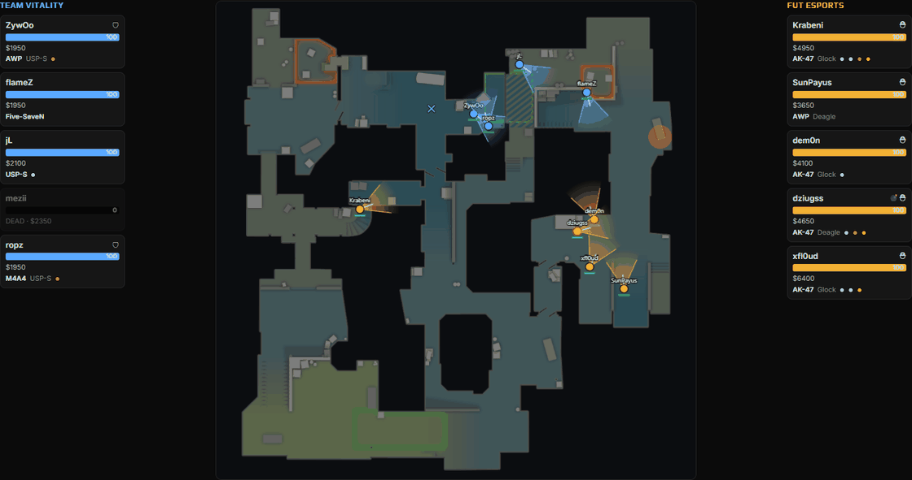
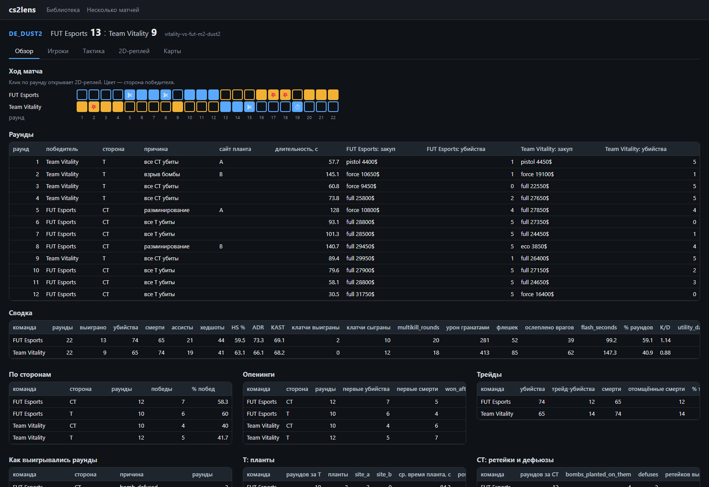
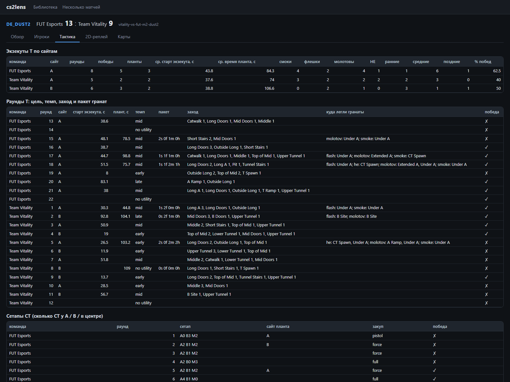
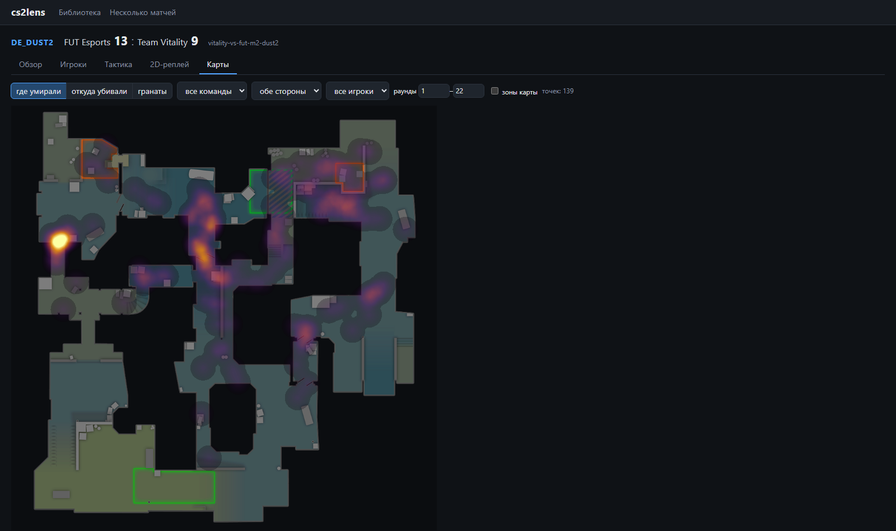
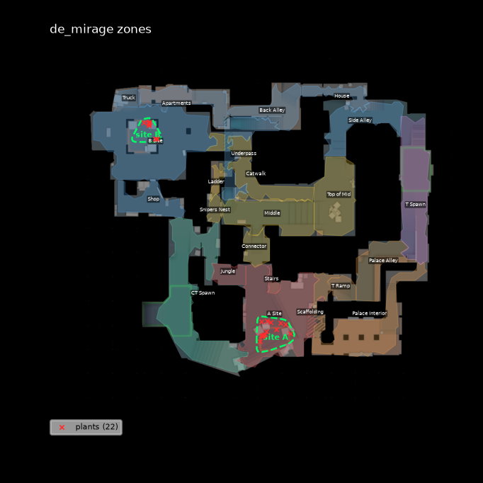
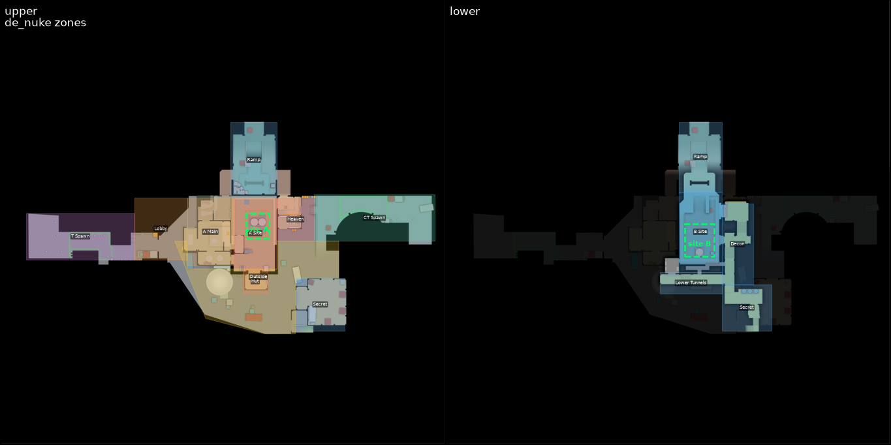

# cs2lens

Анализатор демок Counter-Strike 2. Разбирает `.dem` в таблицы Parquet (через [awpy](https://github.com/pnxenopoulos/awpy) 3), считает командную статистику и тактику (экзекуты T, сетапы и ротации CT), рисует визуализации поверх радара и даёт локальное веб-приложение с 2D-реплеем раундов.



Что умеет:

- **Разбор демки** — все датасеты awpy, все игровые события, снапшоты игроков каждые 0,5 с и кадры для реплея каждые 4 тика.
- **Командная статистика** — счёт, стороны, закупы, причины побед, опенинги, трейды, планты и ретейки.
- **Тактика** — на какой сайт идут T, когда начинают экзекут, какие гранаты и куда бросают, откуда заходят; как CT расставляются и как быстро ротируются.
- **Несколько матчей** — суммы с пересчётом процентов, разбивка по картам и игрокам, склейка названий команд (алиасы).
- **Конфиги карт** — полигоны бомбсайтов и callouts для всего соревновательного маппула, уровни для многоуровневых карт.
- **Приложение** (`cs2lens app`) — библиотека демок с фоновым разбором, страница матча, 2D-реплей, heatmap и карта гранат, агрегат по нескольким матчам. Работает локально в браузере, без интернета.

| Обзор матча | Тактика | Карты |
|---|---|---|
|  |  |  |

## Установка

Нужны Python 3.13 (подойдёт ≥ 3.11) и Node.js (≥ 20) для сборки фронтенда.

```powershell
cd D:\csdemoanalyzer
python -m venv .venv
.venv\Scripts\activate
pip install -e ".[dev]"          # cs2lens + awpy, polars, matplotlib, typer, fastapi, uvicorn; dev — pytest

cd frontend
npm install
npm run build                    # собирает фронтенд в cs2lens/app/static
cd ..
```

Радары и `map_data.json` awpy скачивает один раз в `~/.awpy/<версия>/` (команда `awpy get` или первый вызов `awpy.plot`). Приложение само ничего не скачивает: если радара нет в кэше, вместо него будет пустой фон.

В консоли Windows для кириллицы и спецсимволов в выводе задайте `$env:PYTHONIOENCODING = "utf-8"`.

### Первый запуск

```powershell
cs2lens app                      # http://127.0.0.1:8000, браузер откроется сам
```

В «Библиотеке» добавьте папку с демками (например, `D:\Steam\steamapps\common\Counter-Strike Global Offensive\game\csgo`) или загрузите `.dem`. Нажмите «Разобрать»: разбор идёт в фоне с прогрессом, демка на 300 МБ разбирается примерно за 30 с. Уже разобранные демки повторно не разбираются.

Для выгрузок, сделанных до появления кадров реплея, на карточке матча есть кнопка «данные для реплея». Она дописывает `replay.parquet` из исходной демки за несколько секунд. Без неё реплей тоже работает, но с шагом 0,5 с.

## Команды CLI

```powershell
cs2lens extract demo.dem [--out out] [--snapshot-seconds 0.5]
```
Разбирает демку в `out/<имя демки>/`.

```powershell
cs2lens report  out\Mirage_ArenaPro_vs_LosTopos     # или путь к .dem: разберёт, если ещё не разобрана
cs2lens tactics out\Mirage_ArenaPro_vs_LosTopos
```
Командный и тактический отчёты в Markdown: печатаются в консоль и сохраняются как `team_report.md` / `tactics_report.md` в папке выгрузки.

```powershell
cs2lens batch D:\demos\week1 out\Dust2ArenaPro_vs_teamSirena some.dem --name week1 --alias "team_dr1amwtf=Arena Pro Team"
```
Агрегат по нескольким матчам. Источники — `.dem`, папки с `.dem` или папки выгрузок. Результат — `out/<name>/aggregate_report.md` и таблицы `*.parquet`. `--alias СТАРОЕ=НОВОЕ` можно повторять.

```powershell
cs2lens viz kills   out\<матч> [--side t|ct] [--attacker]   # heatmap мест гибели (или позиций убийц)
cs2lens viz utility out\<матч> [--side t|ct] [--team NAME]  # куда легли гранаты
cs2lens viz frame   out\<матч> 7 --sec 40                   # кадр раунда 7 через 40 с после фризтайма
cs2lens viz gif     out\<матч> 7 [--step-sec 0.5] [--fps 4] # GIF-реплей раунда (matplotlib)
cs2lens viz zones   de_nuke                                 # конфиг карты поверх радара + планты из out/
```
PNG/GIF сохраняются в `out/<матч>/viz/` (`viz zones` — в `out/maps/`). На многоуровневых картах (Nuke) рисуются две панели: верхний и нижний уровень.

```powershell
cs2lens maps list                                           # карты с конфигом, уровни, число зон
cs2lens maps derive a.dem b.dem [--output path.json]        # построить/обновить конфиг карты по демкам
```

```powershell
cs2lens app [--out out] [--host 127.0.0.1] [--port 8000] [--no-open-browser]
```
Запускает веб-приложение.

Разработка фронтенда: `cs2lens app --port 8000` в одном окне и `cd frontend; npm run dev` в другом. Vite проксирует `/api` на порт 8000.

Тесты: `pytest`. Фикстура — раунды 1–8 одного матча Dust2, собранные `tests/make_fixture.py`.

## Где лежат данные

| Путь | Что там |
|---|---|
| `out/<демка>/` | Выгрузка одной демки (см. ниже). |
| `out/<демка>/replay/round_<n>.v<k>.json.gz` | Кэш данных реплея по раундам; создаётся при первом открытии раунда. |
| `out/<демка>/viz/` | Картинки `cs2lens viz`. |
| `out/<name>/` | Результат `cs2lens batch`. |
| `out/maps/` | Отрисовки `cs2lens viz zones`. |
| `out/library.json` | Папки с демками, добавленные в приложении. |
| `out/_uploads/` | Демки, загруженные через приложение. |
| `~/.awpy/<версия>/` | Кэш awpy: радары (`radars/*.png`) и `map_data.json` (преобразование координат, уровни). |
| `cs2lens/maps/<map>.json` | Конфиги карт (в репозитории). |

Демки, выгрузки и `node_modules` в git не попадают (см. `.gitignore`).

### Формат выгрузки

`out/<демка>/`:

- `manifest.json` — заголовок демки (`header.map_name`, …), `tick_rate`, `demo_path`, `replay_every` и число строк каждой таблицы.
- Датасеты awpy: `rounds`, `kills`, `damages`, `shots`, `grenades` (позиция гранаты в каждом тике полёта), `smokes`, `fires`, `blinds`, `bomb`, `item_events`, `players`, `stats`, `round_economy`, `chat`.
- `snapshots.parquet` — состояние всех игроков каждые 0,5 с: позиция, взгляд, HP, броня, оружие, деньги, флаги.
- `replay.parquet` — то же для реплея: каждые 4 тика, только нужные колонки.
- `events/<событие>.parquet` — все игровые события как есть (`weapon_fire`, `smokegrenade_detonate`, …). **Все поля — строки.**

## Поддерживаемые карты

Active Duty маппул CS2 на **30.10.2026**: Ancient, Anubis, Cache, Dust II, Inferno, Mirage, Nuke. Cache заменил Overpass в июле 2026, Anubis заменил Train в январе 2026. Источники: [Wikipedia](https://en.wikipedia.org/wiki/List_of_competitive_Counter-Strike_maps), [neuralboost.gg](https://neuralboost.gg/blog/cs2-maps-every-pool-the-rotation-history-and-what-each-map-demands). У всех семи карт есть радар и `map_data` в используемом релизе awpy-data (2000935); у Nuke есть ещё нижний радар.

| Карта | Конфиг | Как построен | Проверка |
|---|---|---|---|
| de_ancient | ✓ | `maps derive`, 1 демка | реальные демки: 14/14 плантов в полигоне своего сайта |
| de_anubis | ✓ | `maps derive`, 2 демки | реальные демки: 31/31, в т.ч. 19/19 на демке, не участвовавшей в построении |
| de_dust2 | ✓ | `maps derive`, 3 демки | реальные демки: 28/28 |
| de_inferno | ✓ | `maps derive`, 1 демка | реальные демки: 6/6 |
| de_mirage | ✓ | `maps derive`, 2 демки | реальные демки: 22/22 |
| de_cache | ✓ | вручную по радару | **только разметка**: сайты по рамкам на радаре; названия части зон приблизительные |
| de_nuke | ✓ (2 уровня) | вручную по радару | **только разметка**: сайты по рамкам на радарах; названия части зон приблизительные |

Когда появятся демки по Cache или Nuke, перестройте конфиг: `cs2lens maps derive <демки>`. Группы зон, уже заданные вручную, сохранятся по имени зоны.

Для карт вне пула (Overpass, Train, Vertigo, …) конфига нет. `tactics` для них использует запасную эвристику и выводит предупреждение. Визуализации работают на всех картах, у которых есть радар.

| Mirage (построен по демкам) | Nuke (вручную, два уровня) |
|---|---|
|  |  |

## Как устроен проект

```
.dem ──extract──▶ out/<демка>/*.parquet ──context──▶ Match ──▶ team_stats ─┐
                                                         ├──▶ tactics ◀── maps (конфиги карт)
                                                         ├──▶ replay  ├──▶ report (Markdown), viz (PNG/GIF)
                                                         └──▶ aggregate ┘──▶ app (FastAPI + React)
```

| Модуль | Что делает |
|---|---|
| `extract.py` | `.dem` → Parquet: датасеты awpy, события, снапшоты, `replay.parquet`, `manifest.json`. `add_replay()` дописывает кадры реплея к старым выгрузкам. |
| `context.py` | `load_match()` строит общий контекст. Раунды без ножевых. steamid → команда (без тренеров). Сторона команды в каждом раунде. Таблица `tr` (раунд × команда: сторона, победа, закуп, закуп соперника). Шаг и смещение снапшотов. `with_round()` привязывает строки с `tick` к раунду. |
| `team_stats.py` | Сводка, стороны, закупы, причины побед, опенинги, трейды, бомба за T и за CT. |
| `tactics.py` | Экзекуты T, сетапы CT, ротации. `SiteZoner` классифицирует позиции по конфигу карты или по запасной эвристике. |
| `maps/` | Конфиги карт (`<map>.json`) и их загрузка; поиск зоны, группы и сайта для точки через растр. |
| `mapgen.py` | Строит конфиг карты по демкам (`maps derive`). |
| `aggregate.py` | Агрегация по матчам, алиасы команд. |
| `replay.py` | Документ реплея раунда (JSON, gzip-кэш). |
| `viz.py` | Картинки поверх радара (matplotlib через `awpy.plot`), панели по уровням. |
| `report.py` | Markdown-отчёты. |
| `cli.py` | Команды `cs2lens`. |
| `app/server.py`, `app/jobs.py` | FastAPI: библиотека, фоновая очередь разбора, API матча, реплея, карт и агрегата, раздача фронтенда. Анализ не дублирует — вызывает модули выше. |
| `frontend/` | React + TypeScript + Vite. Реплей рисуется на Canvas 2D. |

### Приложение: как работает реплей

Бэкенд собирает раунд в один JSON-документ:

- общая сетка тиков (шаг 4 тика);
- массивы по каждому игроку: `x`, `y`, `z`, `yaw`, `hp`, `armor`, оружие, бомба, кит, дефьюз;
- траектории гранат с бросившим (ближайший к первой точке игрок);
- смоки и молотовы с реальными временами жизни;
- ослепления, убийства, события бомбы, выстрелы.

Документ кэшируется сжатым (60–90 КиБ на раунд). Холодная сборка раунда занимает меньше 0,2 с, повторная загрузка — около 10 мс; следующий раунд подгружается заранее. Клиент интерполирует позиции и углы обзора между кадрами.

Управление реплеем:

| Клавиша | Действие |
|---|---|
| Пробел | пуск/пауза |
| ← / → | кадр назад/вперёд |
| Shift + ← / → | ±5 с |
| ↑ / ↓ | скорость (0,25×–8×) |
| N / P | следующее/предыдущее убийство |
| [ / ] | предыдущий/следующий раунд |
| Home | конец фризтайма |
| 1 / 2 / 3 | верхний / нижний / оба уровня (на Nuke) |

Ссылка `#/match/<матч>/replay/<раунд>/<секунда>` открывает раунд с нужного момента.

## Методика

Все пороги — константы в начале модулей; меняются там же.

**Раунды.** Ножевые раунды исключаются. Строка относится к раунду, если её тик лежит в `[start_tick, end_tick]` (`with_round`). Тики между раундами отбрасываются. Если запись демки началась посреди первого раунда, его `start_tick` пустой и заменяется на 0.

**Стороны.** Сторона команды в раунде — большинство по снапшотам её игроков в этом раунде. Команда — `team_clan_name` из `players`. Тренеры — строки `stats` без убийств, смертей, ассистов и урона — исключаются из игроков и средних.

**Трейды и опенинги.** Признаки `is_trade` и `victim_traded` берутся из awpy: убийство, отомстившее за тиммейта в течение 5,25 с. Опенинг — первое межкомандное убийство раунда.

**Зоны карты.** Каждая зона конфига относится к группе:
- `A` / `B` — сайт и позиции CT вокруг него (например, Jungle и Stairs на Mirage);
- `A_approach` / `B_approach` — пути T к сайту;
- `mid`, `t_spawn`, `ct_spawn`.

Точка ищется по полигонам своего уровня (по `z`). Если зоны пересекаются, побеждает меньшая. Точки в пределах 64 юнитов от зоны приписываются к ближайшей (`maps/__init__.py`: `CELL`, `SNAP`).

**Как строится конфиг по демкам** (`mapgen.py`):
- **Callouts.** Каждая позиция игрока помечена игрой названием nav-места (`m_szLastPlaceName`). Позиции раскладываются в клетки по 32 юнита отдельно для каждого уровня. Клетка получает самое частое место. Мелкие дыры закрываются, островки убираются. Контуры строятся marching squares и упрощаются (`CELL`, `MIN_SAMPLES`, `MIN_CELLS`, `SIMPLIFY`).
- **Сайты.** Флаг `m_bInBombZone` (то же, что `func_bomb_target`) выставляется только у T. Сайт — выпуклая оболочка кластера таких точек. К ней добавляются планты своего сайта, оболочка расширяется на `ZONE_PAD` = 40 юнитов. Буква сайта берётся по плантам внутри, иначе по названию места.

**Экзекуты T** (`tactics.py`).
- Учитывается граната, которая легла в зону группы `A`/`B`. Граната в CT spawn считается за ближайший сайт: это CT-смоки.
- **Целевой сайт** — сайт планта; без планта — сайт, куда легло больше всего гранат T до конца раунда.
- **Старт экзекута** — первая граната T на целевом сайте.
- **Темп** — по времени старта от конца фризтайма: раньше `EARLY_SEC` = 30 с — early, с 30 до `LATE_SEC` = 60 с — mid, позже — late.
- **Пакет** — гранаты на сайт планта от старта экзекута до планта.
- **`entry`** — в каких зонах были живые T в момент старта. Если старта нет — за `PACKAGE_SEC` = 25 с до планта.
- **`package_zones`** — в какие callouts легли гранаты пакета.
- **Кто бросил.** У гранат в этих демках пустой `thrower_*`. Бросившего восстанавливаем так: `events/weapon_fire.userid` построчно сопоставляется с `shots.steamid` (`userid_map`). Молотов привязывается к последнему броску `grenade_thrown` не раньше чем за 6 с до возгорания.

**Сетапы CT.**
- Позиции живых CT берутся через `SETUP_SEC` = 15 с после фризтайма или в момент первого контакта, если он раньше. Первый контакт — первый урон по сопернику.
- CT в группе `A` или `A_approach` считается игроком A, в `B` / `B_approach` — игроком B, остальные — mid.
- Пример записи: `A2 B2 M1`.

**Ротации CT** (раунды с плантом).
- Точка отсчёта — старт экзекута, иначе плант минус `PACKAGE_SEC`.
- Ротирующие — CT, которые в этот момент не в группе сайта планта.
- Ротирующий «доехал», когда впервые оказался в группе сайта до конца раунда.
- Считаются среднее число ротирующих и доехавших (в том числе до планта), среднее время ротации и процент выигранных ретейков.

**Запасная эвристика** — для карт без конфига; при её использовании выдаётся предупреждение.
- Центры сайтов — средние позиции плантов в демке, поэтому нужен хотя бы один плант на каждом сайте.
- «На сайте» — ближе `SITE_RADIUS` = 0,20 расстояния A–B.
- «Держит сайт» — ближе `DEFEND_RADIUS` = 0,40 расстояния A–B.
- Подобрана на de_anubis.

**Агрегация.** Счётчики суммируются, проценты и отношения пересчитываются из сумм. Средние (ADR, время планта, …) взвешиваются по своему знаменателю. Одна демка, добавленная дважды, даёт удвоенные счётчики и те же проценты (это проверяется тестом). Тактика всегда разбивается по картам.

## Ограничения и особенности данных

- **Гранаты без бросившего.** В `grenades`/`smokes`/`fires` пустой `thrower_*`, бросивший восстанавливается (см. «Экзекуты T»). Если `weapon_fire` и `shots` не совпадают построчно, тактика и карта гранат для матча недоступны: в CLI будет ошибка, в приложении — сообщение.
- **Пустой `start_tick` первого раунда** у части демок (запись началась во время раунда) — заменяется на 0.
- **События хранят поля строками**, `x`/`y`/`z` приводятся к числу.
- **Снапшоты** идут с шагом 0,5 с (`Match.snap_step`, при 64 тиках это 32 тика). На части демок тики снапшотов начинаются с 1, а не с 0 (`Match.snap_offset`); раньше из-за этого сетапы, ротации и `viz frame/gif` на таких демках были пустыми.
- **Прогресс разбора.** awpy не сообщает прогресс внутри разбора, поэтому он показывается по этапам. Первый этап («parsing demo») — самый долгий.
- **Сайты по демкам строятся по позициям игроков**, поэтому край зоны закладки может быть неточным в пределах ~40 юнитов. Сайты, где T почти не стоят, получаются меньше реальных.
- **Cache и Nuke не проверены на демках**: возможны неточности в названиях и границах вспомогательных зон.
- **Бросивший гранату в реплее** — ближайший живой игрок к первой точке траектории (до 120 юнитов). При бросках вплотную к тиммейту возможна путаница.
- **Тренеры** определяются по нулевой строке в `stats`; тренер, который реально играл раунды, считается игроком.
